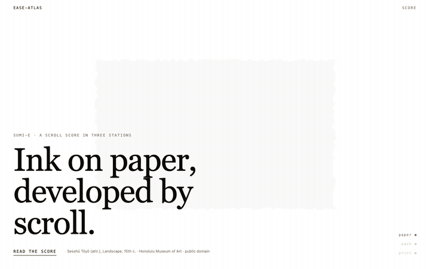

# ease-atlas



**Ink Hero**, Featured on 21st.dev: a scroll hero whose image develops from ink
wash to print as you scroll. [Live demo](https://ease-atlas.vercel.app) ·
[Registry page](https://21st.dev/@ryanonline1234/components/ink-hero)

```bash
npx @21st-dev/cli add @ryanonline1234/ink-hero
```

What you need: React 19 and Tailwind v4; `gsap` and `@gsap/react` are installed
for you. The 21st CLI asks for a free 21st.dev API key. Works as-is in Next.js
App Router (it is a Client Component) and in Vite. shadcn/ui theme tokens are
recommended, not required. A cross-origin image needs CORS headers for the
dissolve, otherwise it is shown with a plain frame; with no image at all the
dissolve paints ink ridges.

Part of a small set of web-motion primitives for React built on measured
easing constants rather than invented ones. EaseAtlas, the curve instrument,
is published by link only:
[registry page](https://21st.dev/@ryanonline1234/components/ease-atlas) ·
`npx @21st-dev/cli add @ryanonline1234/ease-atlas`. This repository is canonical;
the registry is a mirror.

## InkHero

A sticky hero scored in three stations. As you scroll, an image develops from
a faint ink wash to a full print, the frame grows from a small sheet to full
bleed, the headline bleeds in line by line, and the nav settles. Every leg of
the score runs on a named curve (default: `ink`, observed on
oneshot-sakura.vercel.app), and the demo's controls retime it live with any
curve from the atlas.

- **Paper** (h = 0): bare paper, a faint sheet where the print will be, the
  eyebrow and headline bleed in on `expo.out`.
- **Wash** (h = 0.5): the image is half developed and desaturated, the sheet has
  grown, the marker on the station rail moves.
- **Print** (h = 1): full bleed, full contrast, the scrim and nav settle, the
  caption and call to action arrive last.

How it is built, per the scroll-architecture rules this project follows: a
static 400vh section with a `position: sticky` stage (no pin spacer), **one**
ScrollTrigger that publishes one progress value, every effect a window of that
value written through quick setters, and one WebGL2 surface that renders only
when the scroll moves. The dissolve shader is authored from first principles
(an integer hash, value noise, five-octave fbm, a feathered threshold with an
ink-tinted band, a hand-brushed frame edge, static paper grain). Under
`prefers-reduced-motion: reduce` the component renders the finished print as a
static, complete page with no scroll travel; without WebGL2 an `` with a
clip-path frame takes over. The demo wires Lenis on the window through the GSAP
ticker and snaps to the two stations with `lenis/snap`; the component itself
never owns scroll.

Single file: [`src/components/ui/ink-hero.tsx`](src/components/ui/ink-hero.tsx)
(React, GSAP ScrollTrigger). Demo with the controls contract:
[`src/demos/ink-hero/default.tsx`](src/demos/ink-hero/default.tsx), using a
public-domain landscape attributed to Sesshū Tōyō (Honolulu Museum of Art).

| Prop | Default | What it does |
|---|---|---|
| `image` | procedural ink ridges | `{ src, alt }`. Cross-origin needs CORS for the dissolve; without it the image shows in a plain frame and one warning is logged |
| `headline` | — | A string with newlines or an array of lines; each line gets its own mask |
| `eyebrow`, `caption`, `cta`, `nav` | — | The small type around the headline |
| `ease` | `'ink'` | A `NAMED_CURVES` key, a `cubic-bezier()` string, or a GSAP ease name |
| `travel` | `300` | Scroll travel in vh beyond the first screen |
| `feather` | `0.18` | Dissolve edge softness |
| `grain` | `0.35` | Paper grain |
| `noiseScale` | `3` | Finer or coarser islands in the dissolve |
| `dprCap` | `1.5` | Canvas device-pixel-ratio cap |

| `inkColor` | theme foreground | CSS color of the ink at the front |
| `pointerDevelops` | `true` | A fine pointer develops the print where it rests; off on touch and under reduced motion |
| `onStation` | — | `(0 \| 1 \| 2) => void` when the station changes |
| `scrollTo` | `window.scrollTo` | How the station rail scrolls; pass your Lenis instance's `scrollTo` when you run one |

The score itself is data (`WINDOWS` in the component): a pair of h values per
effect. Retiming is editing two numbers. The station rail is a set of buttons
that scroll to each station, and the front is tuned to read as ink, not fog:
fine islands, a speckled edge, and a thin dark rim where the ink pools as it
dries.

## EaseAtlas

A grid of 24 named easing curves. Each cell draws the curve as an SVG glyph and
rides a marker through the plot using the identical sampled function as a CSS
`linear()` timing function. One function feeds both, so the drawing and the
motion cannot disagree. A faint second marker rides the diagonal so the lead or
lag against linear is visible at every moment. Click a cell to copy the curve as
CSS (`cubic-bezier()` or `linear()`), as a GSAP ease (or a `CustomEase.create`
call), or as a CSS custom property.

The 24 curves and their sources: the easings.net bezier twins of GSAP's
`power1–4.out`, `expo.out/in/inOut`, `power2.inOut` and `back.out`; the CSS
`linear` and `ease` keywords as references; Emil Kowalski's `ease-out`,
`ease-in-out` and the Vaul drawer curve; Material 3 and IBM Carbon system
curves; GSAP's `elastic.out` and `bounce.out`; and three curves observed on
published sites (osmo.supply, lusion.co, oneshot-sakura.vercel.app), listed as
observed values with the site named on the card.

Single file, no runtime dependency beyond React:
[`src/components/ui/ease-atlas.tsx`](src/components/ui/ease-atlas.tsx). Demo
with a live controls panel: [`src/demos/default.tsx`](src/demos/default.tsx).

| Prop | Default | What it does |
|---|---|---|
| `curves` | the 24-entry `ATLAS` | Any `AtlasEntry[]`; values in cubic-bezier, GSAP, Penner, CSS keyword or CustomEase path notation |
| `columns` | `4` | Columns at full width; the grid drops columns on narrow containers |
| `duration` | `1200` | Ride duration in ms; the viewer is watching, not waiting |
| `autoplay` | `false` | Loop every curve; otherwise a curve rides on hover or focus |
| `showGhost` | `true` | The linear comparison marker |
| `showCode` | `false` | Print the CSS value under each curve instead of its source |
| `format` | `'css'` | Initial copy format: `'css'`, `'gsap'`, `'token'` |
| `onCopy` | — | `(entry, text) => void`, called after every copy |

Styling uses shadcn-style semantic tokens only (`bg-card`, `text-primary`,
`border-border`, …). Under `prefers-reduced-motion: reduce` nothing animates
and every marker sits at the end of its curve. Cells are buttons; the format
switch is a keyboard-operable radio group; copies are announced to screen
readers.

**Browser support to confirm before relying on it:** the ride uses the CSS
`linear()` easing function through the Web Animations API. Chrome 113+, Safari
17.2+ and Firefox 112+ ship it at the time of writing; check caniuse for your
targets.

## Verification

```bash
npm test            # 43 unit tests: parsers, samplers, the score's track table, atlas integrity, copy text, component behaviour
npm run typecheck
npm run probe       # Chromium: the atlas ride measured against f(t); the hero's shader/context/console checks, reduced-motion page, theme captures
npm run dev         # playground at http://localhost:5178 (?demo=ink-hero or ?demo=ease-atlas, &dark=1 for dark)
```

The hero is measured, not eyeballed, with the awwwards-motion harness. The scroll
spec was written before the component existed
([`tests/ink-hero/scroll-spec.json`](tests/ink-hero/scroll-spec.json)):
stations, windows, ease-shape probes, pin behaviour, and the after section's
release. The capture pauses the page at 42 scroll positions and reads the CSS
variables the component publishes (`--ink-progress`, `--ink-develop`,
`--ink-inset`, `--ink-wash`, `--ink-station`, `--ink-line-1/2`, `--ink-nav`),
the scrim's opacity, the stage's position, and the headline's effective
opacity.

```bash
S=~/.claude/skills/awwwards-motion/scripts
node $S/capture_motion.mjs sample "http://localhost:5178/?demo=ink-hero&dark=0" --spec tests/ink-hero/scroll-spec.json --out tests/ink-hero/out/samples.json --viewport 1440x900 --dpr 1 --color-scheme light --wait-for-fonts
node $S/assert_scroll_spec.mjs tests/ink-hero/scroll-spec.json tests/ink-hero/out/samples.json
node $S/capture_motion.mjs stills "http://localhost:5178/?demo=ink-hero&dark=0" --positions 0,0.1875,0.375,0.5625,0.75,1 --out tests/ink-hero/out/stills --viewport 1440x900
node $S/capture_motion.mjs jank "http://localhost:5178/?demo=ink-hero&dark=0" --viewport 1440x900
python3 $S/analyze_frames.py tests/ink-hero/out/stills --montage tests/ink-hero/out/sheet.png
```

Results on 2026-10-09: 72 of 76 checks pass (the other four are two warnings
and two invariants the capture format cannot record); the positive control,
a deliberately dead develop track, fails five checks including the
"value never changed" catch; frame timing at 120 Hz on an Apple M1 Pro has a
median of 8.3 ms, p99 9.3 ms, zero long frames; the flat-frame detector passes;
the shader compiles with no errors, the context is never lost, the console stays
clean, and the reduced-motion page has no animations and no scroll travel.

What measurement cannot tell you, stated plainly: whether the ride *feels*
right at 300vh, whether the dissolve's noise scale reads as ink rather than
fog, and how a mid-range phone GPU holds up. Those are the human pass.

The atlas has its own probe: for all 24 curves it seeks the real animation
and requires the marker to agree with the parsed function to 0.05% on-grid and
1% between stops, with a positive control, a reduced-motion check, and
light/dark captures. Sampling density is adaptive (64 stops unless the
polyline misses the function by more than 0.5%), and the glyph and the ride
always share the same stops.

## The set

1. **InkHero** — built. The signature piece.
2. **EaseAtlas** — built. The instrument; its curves retime the hero.
3. **InkReveal** — next: the dissolve as a standalone media reveal with a `progress` prop.
4. **MaskReveal** — the line-mask text reveal as its own component.
5. **ScrollScore** — the station timeline helper: windows in, quick setters out.

One stack for all five: React 19, TypeScript, Tailwind v4 semantic tokens,
GSAP ScrollTrigger where scroll is involved. One easing vocabulary. One
`data-*` API.

## Non-negotiables

- `prefers-reduced-motion: reduce` yields a static, complete page.
- Compositor-only properties (`transform`, `opacity`, `clip-path`).
- Motion is never the only affordance.
- Every duration, ease, and stagger traces to a named source.

## Provenance

Every block in this repo is authored here. Constants observed on other studios'
published sites are credited by name where they are used. Nothing reconstructed
from someone else's bundle ships. The rule is gate K0 in [DECISIONS.md](DECISIONS.md).

## Where it lives

This repository is canonical. The 21st.dev registry is a mirror. Adoption is
captured monthly in [`metrics/`](metrics/) under the protocol there; views are
never reported, installs, copies, and bookmarks are.

## License

MIT. See [LICENSE](LICENSE).
